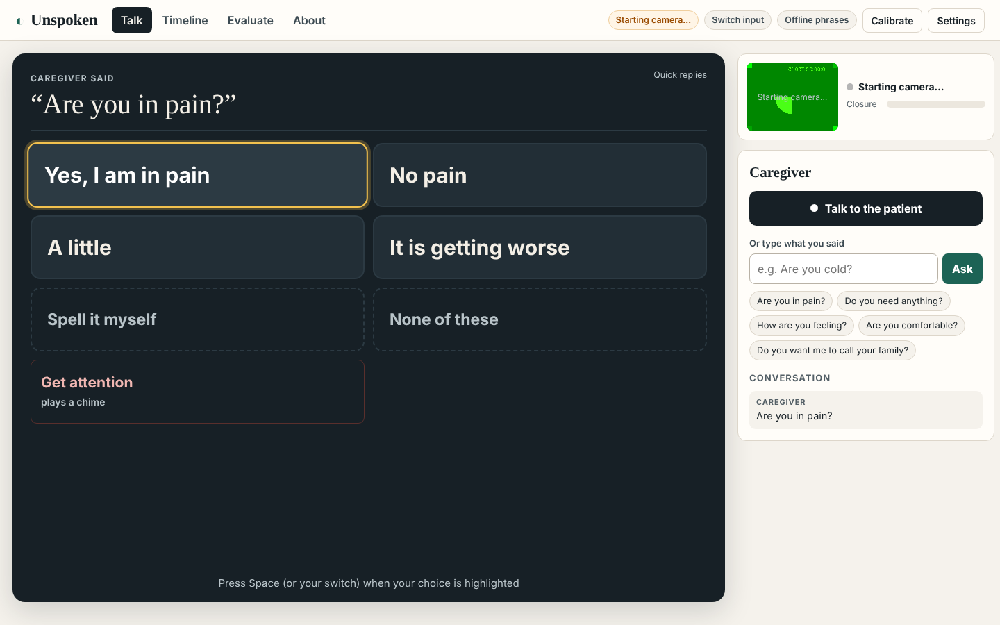
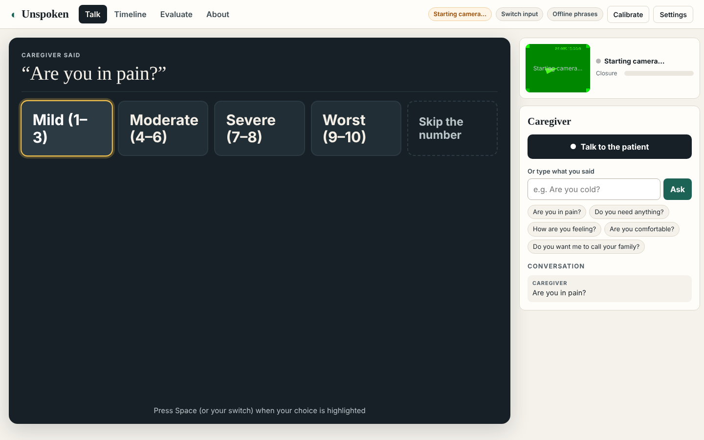
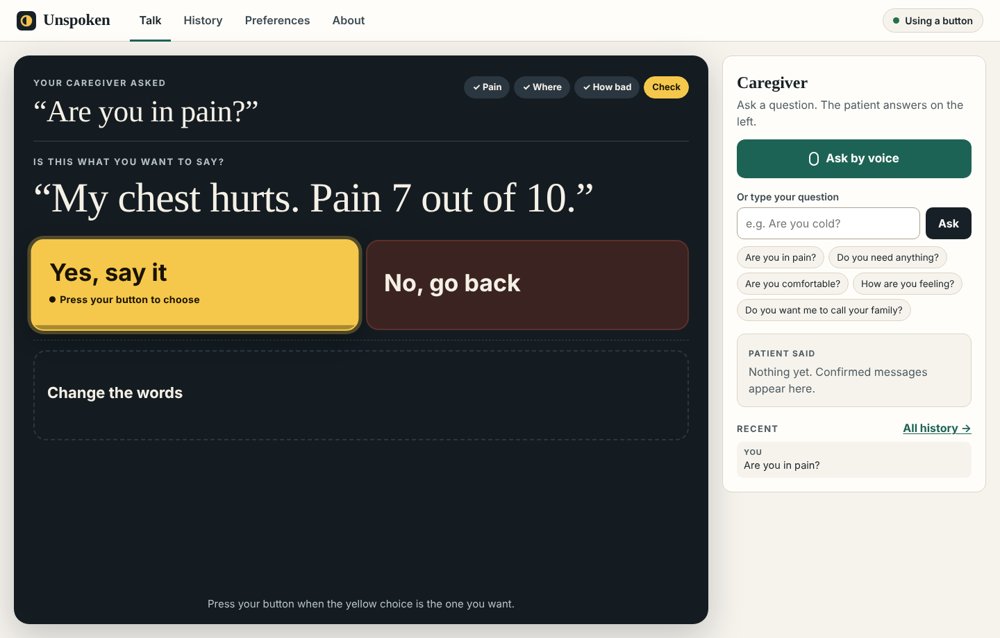
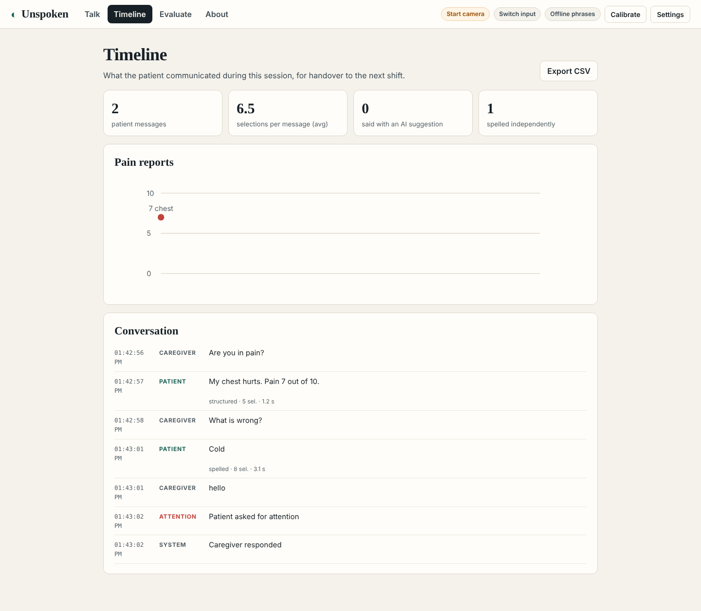
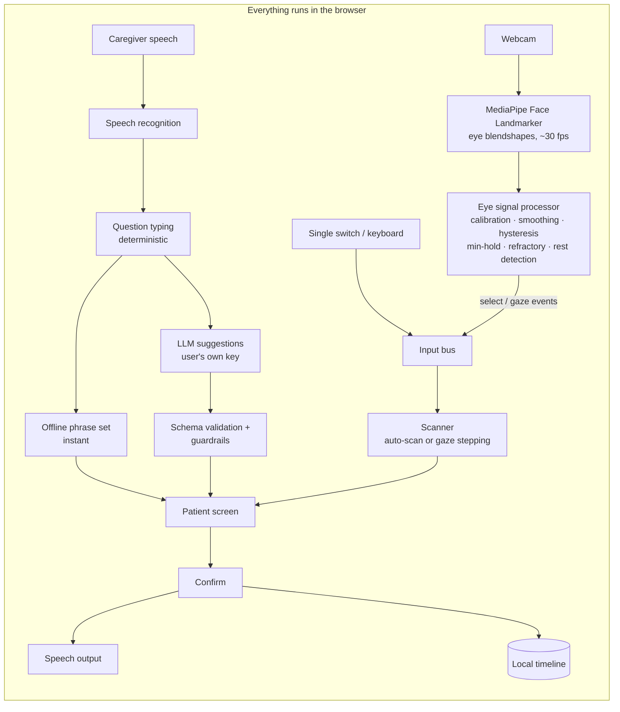

# Unspoken

**A voice for people who are awake but cannot speak, using only an ordinary webcam.**

Unspoken lets a patient on a ventilator, after a stroke, or living with motor neurone disease answer a caregiver using deliberate eye blinks or a single switch. It listens to what the caregiver says and suggests a few likely replies, so a full sentence takes a few selections instead of minutes of spelling. **The patient chooses and confirms every word**, and can always spell something the AI didn't predict.

**Live app:** https://leena17111.github.io/unspoken/ · Built for the [Ctrl+V Hackathon](https://ctrl-v-hackathon-31831.devpost.com/) (accessibility)



## Why

- Mechanically ventilated patients <q>are unable to verbally communicate due to the endotracheal tube or tracheostomy</q>, and there is still <q>no universally acceptable tool for voiceless patients to communicate</q> ([Brambilla et al., 2025](https://www.ncbi.nlm.nih.gov/pmc/articles/PMC11969292/)). Being voiceless causes anxiety, panic, frustration and sleep disturbance.
- In one study of 2,671 ventilated ICU patients, **53.9%** met basic criteria to use assistive communication ([Happ et al., 2015](https://nursing.osu.edu/news/2019/12/10/more-half-mechanically-ventilated-icu-patients-have-ability-communicate)).
- Today's options are yes/no questions, laminated letter boards, or dedicated eye-tracking hardware such as [EyeControl](https://clinicaltrials.gov/study/NCT04582149) that many hospitals don't have. Spelling a sentence on a letter board takes minutes.

## What it does

| | |
|---|---|
| **Eye input on any webcam** | MediaPipe face tracking runs in the browser. Unspoken's own signal processing, calibrated to each person, separates a **deliberate long blink** from natural blinking, with live "hold" feedback and audio cues that work with eyes closed. Glance left/right and single-switch modes are also supported. |
| **Conversation-aware replies** | The caregiver speaks (or types). Unspoken shows quick replies instantly, then upgrades them to AI suggestions grounded in the conversation, if the patient hasn't started choosing yet. |
| **Patient stays in control** | "Spell it myself" and "None of these" are always present. Nothing is spoken until the patient confirms. Rules guard the AI: yes/no questions always get both answers, and doses or treatment decisions are never suggested. |
| **Independent spelling** | Row–column scanning keyboard with frequency layout and local word prediction. Works offline, without AI. |
| **Structured pain reporting** | Location → severity → 0–10 score, logged to a handover **timeline** with a pain chart and CSV export. |
| **Built-in evaluation** | Simulated effort study, 60-second false-selection test and timed message trials, all in the app. |

| Pain path | Confirm before speaking | Handover timeline |
|---|---|---|
|  |  |  |

## Results so far

All numbers are produced by code in this repo. Simulated results (no human participants) are kept separate from live trials. Full details: [docs/EVALUATION.md](docs/EVALUATION.md).

**Communication effort, simulated over 30 scripted exchanges:**

| Method | Avg. time per message | Avg. selections |
|---|---|---|
| Conventional letter-board scanning | 118.6 s | 28.9 |
| Letter board + word prediction | 68.6 s | 16.1 |
| **Unspoken, offline phrases only** | **29.4 s (−75%)** | **7.0** |

**Blink detection on simulated eye signals (10 min per condition):**

| Condition | Fixed threshold, any blink | Fixed threshold + 550 ms | **Unspoken (calibrated)** |
|---|---|---|---|
| Typical | 13.6 false selections/min | 100% detected, 0 false | **100% detected, 0 false** |
| Noisy camera | 15.2 false/min | 92% detected | **100% detected, 0 false** |
| Weak eye closure (e.g. glasses glare) | 58% detected, 1.6 false/min | **0% detected** | **100% detected, 0 false** |

The evaluation also caught a real bug: a long blink during calibration could push the selection threshold above every deliberate blink. It was fixed, with a regression test added (see the commit history).

## Architecture



Design details: [docs/DESIGN.md](docs/DESIGN.md)

## Run it

```bash
npm install
npm run dev        # http://localhost:5173 (allow camera + microphone; use Chrome or Edge)
npm test           # 33 unit tests: signal processing, calibration, scanning, guardrails, spelling, evaluation
npm run eval       # reproduce docs/results (simulation + ablations + blink-detector study)
npm run e2e        # keyboard-only end-to-end run + axe WCAG 2.1 AA checks (needs a local build)
```

AI suggestions are optional. In **Settings**, choose a provider (Groq or Gemini have free tiers; OpenAI and Anthropic are also supported) and paste a key. It is stored only in your browser.

## Honest limitations

- **Not tested with patients.** This is a research prototype, not a medical device. Results above are simulations; live results come from healthy volunteers.
- Eye input depends on lighting, camera angle and the person's ability to close their eyes deliberately. The single-switch mode is the fallback.
- **"Get attention" is a chime, not a nurse-call system**, and must never replace one.
- AI suggestions can be wrong or biased, so the patient confirms every message, can reject all suggestions, and can always spell.
- Speech recognition uses the browser's built-in service (Chrome/Edge send audio to their own servers). The video never leaves the device.

## Privacy

The camera image is processed on-device and never uploaded. The conversation log is stored only in this browser. With AI enabled, only the caregiver's words, recent conversation text and the optional care-context note are sent to the provider you chose.

## License

MIT
